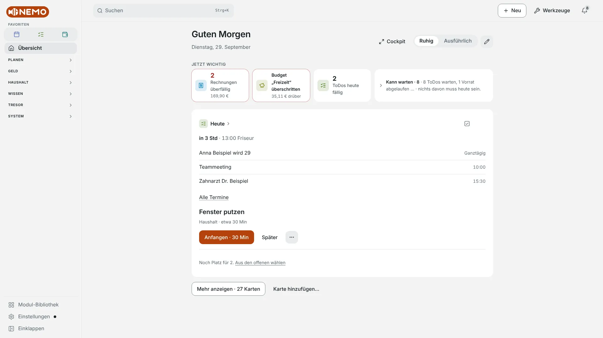
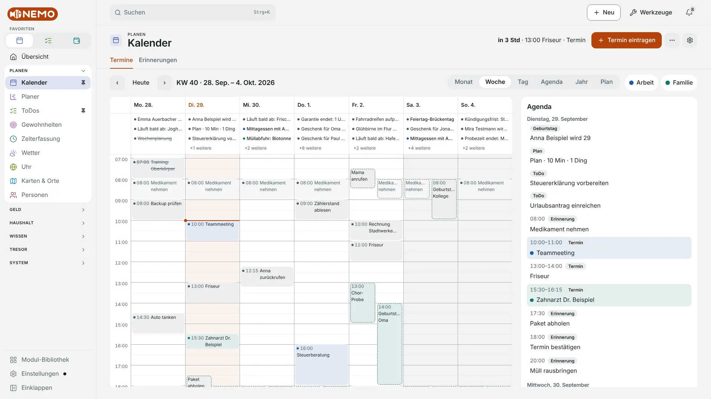
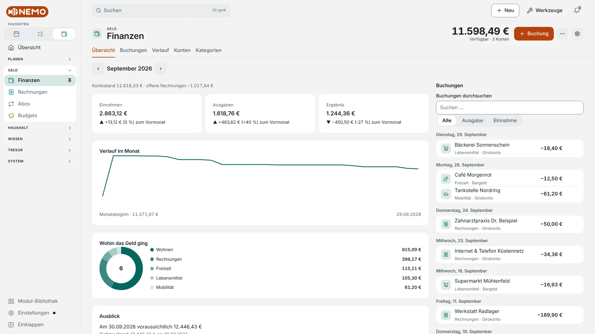
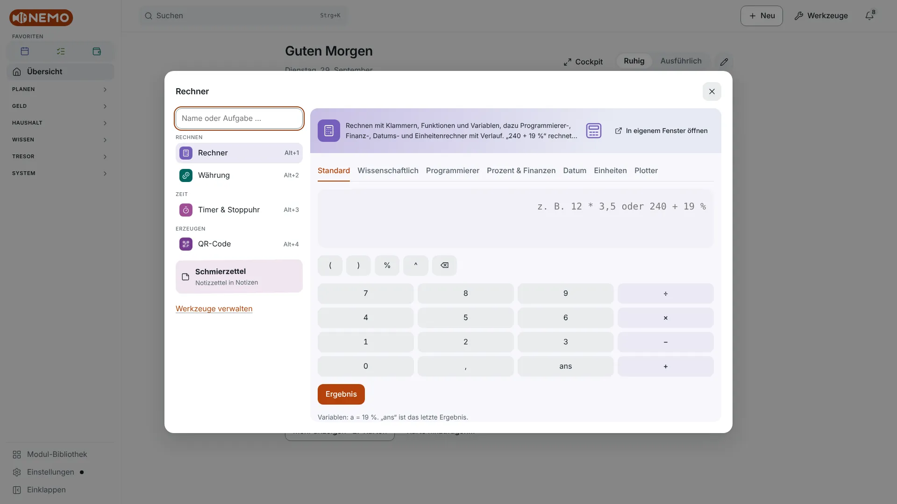
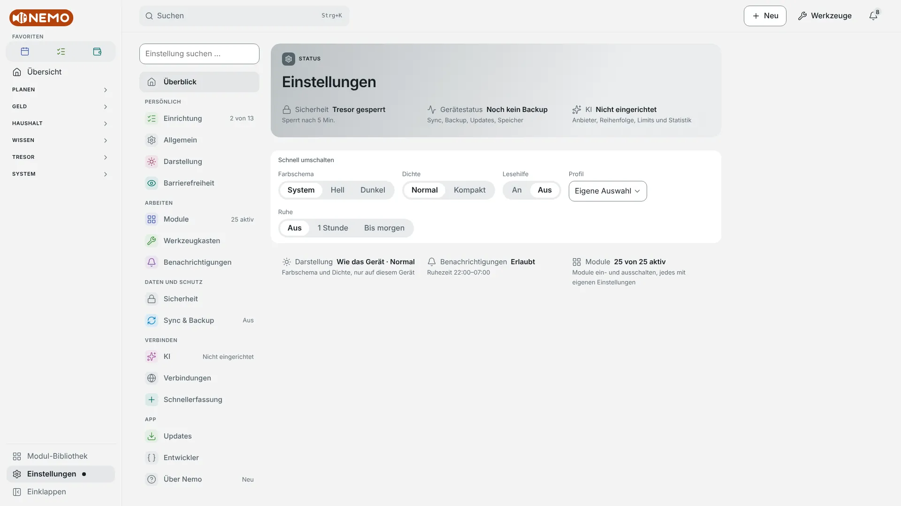
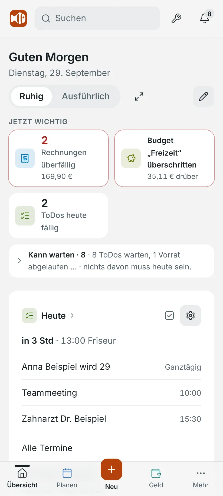
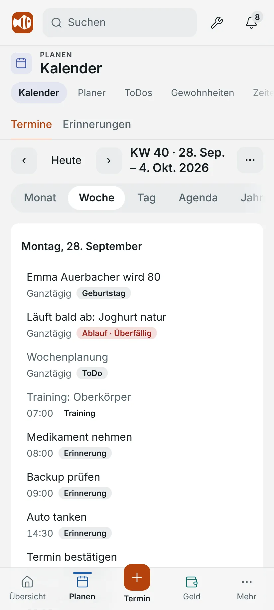
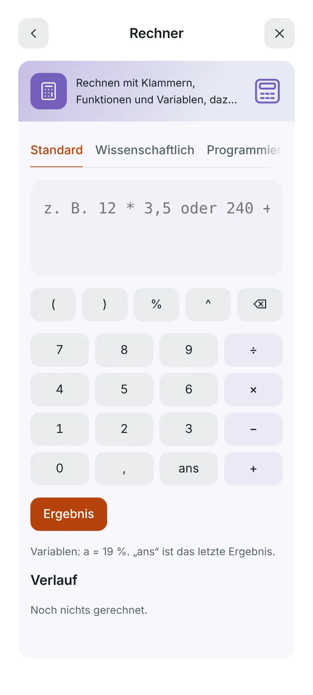

<a href="README.md">English</a> | <strong>Deutsch</strong>

  <picture>
    <source media="(prefers-color-scheme: dark)" srcset="docs/brand/header.de.png">
    
  </picture>

<h1 align="center">Nemo</h1>

Eine ruhige Alltags-App für Windows und Android: Kalender, ToDos, Geld, Passwörter und mehr. Mit ADHS im Blick gebaut, und deine Daten bleiben auf deinem Gerät.

  
  
  
  
  

  
  

> **Stabil oder Dev-Preview?** Die Buttons laden die neueste **stabile** Version. Betaversionen und alle Änderungen stehen auf der Seite [Releases](https://github.com/SGNemo/schweizer-taschenmesser/releases). Die Dev-Preview (siehe *Details* unten) ist ein ungetesteter Stand des Entwicklungszweigs: eine eigene App mit eigenen Daten.

  <picture>
    <source media="(prefers-color-scheme: dark)" srcset="docs/assets/screenshots/overview-desktop-dark.webp">
    
  </picture>

## Was kann Nemo?

Nemo ist eine Sammlung kleiner Module für den Alltag. Was du brauchst, schaltest du in der **Modul-Bibliothek** ein; alles funktioniert offline.

<!-- modules:start -->

| Bereich | Modul | Was es tut | Status |
|---|---|---|---|
| **Planen** | Kalender | Termine in Monats-, Wochen- und Tagesansicht | standardmäßig an |
|  | Planer | Verteilt deine offenen ToDos auf die nächsten Tage | optional |
|  | ToDos | Aufgaben in Listen mit Prioritäten, Fälligkeitsdatum und Unteraufgaben | standardmäßig an |
|  | Gewohnheiten | Tägliche und wöchentliche Ziele mit Ringen | optional |
|  | Zeiterfassung | Start und Stopp mit einem Klick, Projekte und Kunden mit Farbe und Stundensatz | optional |
|  | Wetter | Eine eigene Seite für das Wetter deines Ortes | standardmäßig an |
|  | Uhr | Orte eintragen und ihre Uhrzeit immer sehen | Vorschau |
|  | Karten & Orte | Orte und Wege, die du oft brauchst | Vorschau |
|  | Personen | Geburtstage nie mehr vergessen und Geschenke je Person sammeln | optional |
| **Geld** | Finanzen | Konten, Einnahmen und Ausgaben mit Kategorien | standardmäßig an |
|  | Rechnungen | Offene Rechnungen mit Betrag, Empfänger und Fälligkeit | standardmäßig an |
|  | Abos | Abos und wiederkehrende Zahlungen | standardmäßig an |
|  | Budgets & Sparziele | Monatslimits je Ausgabenkategorie (aus den Finanzen) und Sparziele mit Einzahlungen und Fortschritt | bei Neuinstallationen an |
| **Haushalt** | Listen | Einkauf, Packlisten und Checklisten | bei Neuinstallationen an |
|  | Vorräte | Was ist im Kühlschrank, im Vorratsschrank und im Tiefkühler? | optional |
|  | Fitness | Training und Essen grob festhalten | Vorschau |
| **Wissen** | Merkliste | Links, Lesestoff, Filme, Orte und Ideen merken | optional |
|  | Notizen | Notizblock mit formatiertem Text (Markdown), einem festen Zettel immer oben, Anheften und Suche | optional |
|  | Chat | Gespräche mit dem eingebauten lokalen Modell oder deinen Anbietern | Vorschau |
|  | Browser | Einfacher Browser mit Tabs, Lesezeichen und privatem Modus | Vorschau, nur Windows- und Android-App |
|  | Feeds | Deine abonnierten Feeds (Nachrichten, Blogs, Podcasts) an einem Ort, nach Gruppen sortiert | optional |
|  | E-Mail | Posteingang, Suche und Mails lesen | Vorschau, nur Windows-App |
|  | Musik | Spotify auf einer Seite | Vorschau |
| **Tresor** | Unterlagen | Ausweise, Verträge, Versicherungen und Garantien mit Ende, Kündigungsfrist und angehängter Datei | optional |
|  | Passwörter | Passwort-Tresor | optional |
| **System** | Dieser PC | Laufwerke mit Scan der größten Ordner und Systeminfo (Prozessor, Speicher, Akku, Netzwerk) | optional, nur Windows-App |
|  | Downloads | Lädt Dateien herunter | bei Neuinstallationen an, nur Windows-App |
|  | Fernbedienung | Steuere Medien und Lautstärke deines PCs vom Handy aus | Vorschau, nur Android-App |

„Bei Neuinstallationen an“: eingeschaltet, wenn du Nemo neu installierst. Eine Installation, die es schon gab, bleibt, wie sie ist; dort schaltest du das Modul in der Modul-Bibliothek ein.

**Werkzeuge:** Rechner · Währung · Timer & Stoppuhr · QR-Code · Einheiten · Datumsrechner · Zeitzonen · Würfel & Zufall · Text-Werkzeug · Bilder verkleinern · PDF-Werkzeug · Bildschirmfoto (Vorschau) · Anonyme Persona · Entwickler · Textvergleich (Vorschau) · Regex-Tester (Vorschau). Öffnen mit Strg+. oder dem Knopf „Werkzeuge“; weitere schaltest du unter „Werkzeuge verwalten“ ein.

Vorschau-Module und -Werkzeuge bleiben versteckt, bis du „In Arbeit anzeigen“ einschaltest (Einstellungen → Darstellung).

<!-- modules:end -->

Mit **Strg+K** durchsuchst du deine Module, springst überallhin oder stellst eine Frage; die Suche rechnet auch („240 + 19 %“). **Schnell erfassen** macht aus einer Textzeile einen Eintrag: globales Tastenkürzel und Tray unter Windows, Teilen-Menü und App-Symbol-Kurzbefehle unter Android. Mehr: [Module und Werkzeuge](docs/user/modules.de.md), [Suche und KI](docs/user/ai-assistant.de.md).

### Gemacht für volle Köpfe

Nemo ist mit ADHS im Blick gebaut. Es hilft beim Anfangen und Dranbleiben; es ist keine Behandlung und verspricht auch keine. Jede Hilfe lässt sich abschalten.

- **Jetzt dran:** Die Übersicht schlägt eine Sache zum Anfangen vor, mit erstem Schritt und Dauer. Der Rest wartet, eingeklappt.
- **Tagesplan und Fokusmodus:** ein paar Dinge für heute; eine Aufgabe nach der anderen mit ihren Schritten und einem Ring-Timer.
- **Ruhige Erinnerungen:** Ruhezeiten, gebündelt, „später“ mit sinnvollen Optionen, keine Serien, die man verlieren kann. Sie erreichen eine geschlossene App unter Android, eine laufende App unter Windows (sie darf im Tray bleiben) und im Browser per Web-Push über deinen eigenen Sync-Server.
- **Leichter zu lesen:** größere Schrift, weniger Bewegung, eine Lesehilfe (Vorschau) und Profile (Ruhig, Arbeit, Abends) mit Zeitplänen.

### KI, optional

- **Auf deinem Gerät, kostenlos:** Eingebaute Regeln beantworten einfache Fragen („Was steht heute an?“) und machen aus einem Satz wie „Rechnung Stadtwerke 89,90 € fällig 15.10.“ einen Eintrag, immer zuerst mit Vorschau. Die Regeln verstehen vorerst **nur Deutsch**.
- **Lokales Modell (Windows-App):** Ein optionales Modell läuft nach einem einmaligen Download offline.
- **Anbieter deiner Wahl:** Claude, OpenAI, Gemini, Groq, OpenRouter, Mistral, Ollama oder dein eigener OpenAI-kompatibler Server, der Reihe nach gefragt (lokal → kostenlos → bezahlt) mit Limits und Kostenübersicht.
- **Import mit einer KI:** Ein KI-Werkzeug kann vorhandene Daten über eine lokale Schnittstelle liefern (Windows-App, standardmäßig aus, die Einstellung ist noch Vorschau): [KI-Import](docs/AI-IMPORT.de.md).
- **Mit einem Schalter aus:** Einstellungen → KI → „KI komplett abschalten“.

### Verbindungen und Import, optional

- **Google** (Windows-App, mit deiner eigenen Client-ID): Kalender und E-Mail (Vorschau), nur lesend, solange du nicht mehr erlaubst. **Spotify** (Vorschau; Windows-App und Browser, nicht Android): was läuft und deine Playlists; Nemo spielt selbst nichts ab. **Kalender-Abos:** jeder iCalendar-Link, ohne Anmeldung.
- **Aus einer anderen App importieren:** Evernote, Obsidian und Markdown, Todoist, Google Tasks, Keep und Kalenderdateien, Notion, Microsoft To Do, Bankdateien, Exporte von Bitwarden, KeePass und 1Password, OPML. Jeder Import zeigt zuerst eine Vorschau und lässt sich rückgängig machen; Passwort-Exporte laufen über den eigenen Import des Tresors, der dein Master-Passwort braucht.

## Bildschirmfotos

Alle Bilder zeigen erfundene Beispieldaten in der deutschen Oberfläche; die App gibt es auch auf Englisch.

<table>
  <tr>
    <td width="50%">
      <picture>
        <source media="(prefers-color-scheme: dark)" srcset="docs/assets/screenshots/calendar-desktop-dark.webp">
        
      </picture>
       Kalender: Wochenansicht mit der Agenda des Tages
    </td>
    <td width="50%">
      <picture>
        <source media="(prefers-color-scheme: dark)" srcset="docs/assets/screenshots/finance-desktop-dark.webp">
        
      </picture>
       Finanzen: Monatsübersicht mit Kontostand und Buchungen
    </td>
  </tr>
  <tr>
    <td width="50%">
      <picture>
        <source media="(prefers-color-scheme: dark)" srcset="docs/assets/screenshots/tools-desktop-dark.webp">
        
      </picture>
       Werkzeugkasten: der Rechner, eines von vielen kleinen Werkzeugen
    </td>
    <td width="50%">
      <picture>
        <source media="(prefers-color-scheme: dark)" srcset="docs/assets/screenshots/settings-desktop-dark.webp">
        
      </picture>
       Einstellungen: der Status auf einen Blick, dann die Kategorien
    </td>
  </tr>
</table>

  <picture>
    <source media="(prefers-color-scheme: dark)" srcset="docs/assets/screenshots/overview-phone-dark.webp">
    
  </picture>
  <picture>
    <source media="(prefers-color-scheme: dark)" srcset="docs/assets/screenshots/calendar-phone-dark.webp">
    
  </picture>
  <picture>
    <source media="(prefers-color-scheme: dark)" srcset="docs/assets/screenshots/tools-phone-dark.webp">
    
  </picture>

## Schnellstart

1. **Herunterladen:** Windows-Portable (eine Datei, keine Installation) oder Android-APK, Buttons oben.
2. **Starten:** Unter Windows die Datei doppelklicken (beim ersten Mal fragt SmartScreen: „Weitere Informationen“ → „Trotzdem ausführen“). Unter Android die APK öffnen und die Installation aus dieser Quelle erlauben.
3. **Einrichten:** Der Einrichtungsassistent führt durch Module, Tresor, optionalen Sync und KI. Alles ist optional und später in den Einstellungen änderbar.

Genauer, inklusive Browser (PWA) und Umstieg von einer anderen App: [Installation](docs/user/installation.de.md).

## Datenschutz in Kürze

- **Lokal gespeichert.** Daten liegen in der Datenbank deines Geräts. Kein Konto, kein Nemo-Cloud-Dienst.
- **Sync optional.** Nur über einen Server, den du selbst betreibst (Docker oder Node), auf Wunsch Ende-zu-Ende verschlüsselt.
- **Nur, was du einrichtest, verlässt das Gerät.** Update-Abfrage (GitHub, abschaltbar), KI-Anbieter, Google- und Spotify-Verbindung, Kalender-Abos, Karten (Kacheln, Ortssuche, Routen), Wetter (nur mit gewähltem Ort), Währungskurse, Downloads, Modell-Download. Was wann gesendet wird: in der App unter Einstellungen → Über Nemo → Rechtliches und in [DATA-FLOWS](docs/legal/DATA-FLOWS.md).
- **Nie Nutzerdaten an KI.** Der Assistent schickt nur deine Frage, das Datum und Feldnamen, niemals Einträge. Ausnahmen gibt es nur, wenn du sie selbst auslöst: im Chat Daten eines Moduls anhängen (mit Vorschau) oder einer KI über die lokale Schnittstelle Leserechte geben. Der Passwort-Tresor (Argon2id, AES-256, Einmalcodes) ist für KI, Suche und Import komplett unsichtbar.
- **Signierte Updates.** Jede Aktualisierung wird vor dem Einspielen mit dem Schlüssel des Projekts geprüft. Details: [Sicherheit](docs/user/security.de.md).

## Details

<strong>Installation: Windows, Android, PWA</strong>

**Windows:** eine portable Datei, keine Installation und keine Adminrechte. Voraussetzung ist Microsoft WebView2 (auf Windows 10/11 meist vorhanden). Beim ersten Start kann „Der Computer wurde durch Windows geschützt“ (SmartScreen) erscheinen, weil die exe kein gekauftes Code-Signing-Zertifikat hat: „Weitere Informationen“ → „Trotzdem ausführen“. Der Update-Inhalt ist mit dem Schlüssel des Projekts signiert, die App prüft diese Signatur selbst. Daten liegen im Benutzerprofil unter `%LOCALAPPDATA%\io.github.sgnemo.taschenmesser`; ein leerer Ordner `data` neben der exe macht sie portabel (USB-Stick). Updates: Einstellungen → Updates, zuerst mit automatischer Sicherungskopie.

**Android:** APK öffnen und „Von dieser Quelle zulassen“ für den Browser oder Dateimanager erlauben. Spätere Updates: Einstellungen → Updates → „Jetzt aktualisieren“. Die App lädt das Update, prüft die Prüfsumme und übergibt an den Android-Installer, der nur APKs mit demselben Signaturschlüssel akzeptiert.

**PWA:** In Chrome oder Edge (Windows) oder Chrome (Android) „App installieren“ wählen (braucht HTTPS oder localhost). Auf dem iPhone lässt sich die PWA im Browser nutzen, ohne Push.

Vollständige Anleitung: [Installation](docs/user/installation.de.md).

<strong>Dev-Preview: ungetestete Stände</strong>

Nach einem grünen Push auf `develop`, der Code ändert, baut GitHub eine Vorschau: <a href="https://github.com/SGNemo/schweizer-taschenmesser/releases/download/dev-preview/Nemo-Portable-dev.exe">Windows</a> · <a href="https://github.com/SGNemo/schweizer-taschenmesser/releases/download/dev-preview/Nemo-dev.apk">Android</a>. Sie ist für Tester gedacht und kann Fehler enthalten. Das ist eine **eigene App „Nemo Dev“ mit eigenen Daten** und ersetzt die stabile App nicht; Daten kommen per Sync oder Backup hinüber. Der Update-Kanal steht unter Einstellungen → Updates.

<strong>Sync-Server und Backup: eigener Server, Docker, Tailscale, Push</strong>

Ein kleiner Node-Server (Fastify + SQLite) mit Token-Login. Das Docker-Image baust du aus dem Repository (`server/`; es liefert auch die PWA aus, ein veröffentlichtes Image gibt es noch nicht) oder startest den Server direkt mit Node. Von unterwegs am einfachsten über Tailscale mit HTTPS; optional Web-Push für Erinnerungen an die PWA bei geschlossener App. Backups sind verschlüsselte Dateien (Einstellungen → Sync & Backup), in den installierten Apps auch automatisch. Anleitungen: [Sync-Server](docs/user/sync.de.md), [Backup](docs/user/backup.de.md).

<strong>Lokales KI-Modell (Windows-App)</strong>

Einstellungen → KI → „Lokales Modell“ lädt einmal ein Modell herunter (von Hugging Face) und antwortet danach offline. Es ist der erste Schritt bei „Mit KI eintragen“ und treibt das Chat-Modul (Vorschau) ganz ohne Anbieter an. Es braucht einen Prozessor mit AVX2; eine Grafikkarte wird genutzt, wenn eine gefunden wird. Anleitung: [Suche und KI](docs/user/ai-assistant.de.md).

<strong>Browser-Erweiterung (Brave)</strong>

Hilft beim Registrieren und Anmelden auf Webseiten mit dem Tresor der Windows-App: kein eigener Tresor, und nichts wird ohne deinen Klick ausgefüllt oder gespeichert. Sie ist für Brave gebaut (die Verbindung zur App ist auch für Chrome, Edge und Chromium eingetragen) und wird entpackt aus dem Build-Artefakt `nemo-extension-*.zip` installiert; in einem Store gibt es sie nicht. Anleitung: [Browser-Erweiterung](docs/user/browser-extension.de.md).

<strong>Supporter-Code: freiwillig, nur kosmetisch</strong>

Nemo ist und bleibt kostenlos, alle Funktionen stehen allen offen. Wer das Projekt freiwillig über [Ko-fi](https://ko-fi.com/nemojr) unterstützen möchte (jeder Betrag, einmalig), bekommt als Dankeschön einen Supporter-Code per Mail. Er schaltet rein kosmetische Extras frei: ein „Danke“-Abzeichen, zusätzliche Farbthemen und das Logo in der Themenfarbe. Den Code gibst du unter Einstellungen → Über Nemo → Supporter ein; er wird nur auf deinem Gerät geprüft, ohne Konto und ohne Tracking. Bezahlt wird ausschließlich auf der Seite des Zahlungsanbieters, die App verarbeitet keine Zahlungsdaten. Mehr: [SUPPORT.md](SUPPORT.md).

<strong>FAQ</strong>

- **Warum warnt Windows beim ersten Start?** Die exe hat kein gekauftes Code-Signing-Zertifikat. Der Update-Inhalt ist trotzdem signiert und wird von der App geprüft.
- **Gibt es eine iOS-Version?** Nein. Auf dem iPhone lässt sich die PWA im Browser nutzen (ohne Push).
- **Kann ich meine Daten exportieren?** Ja, Einstellungen → Sync & Backup erzeugt eine Datei mit allem außer Zugangsdaten; der Tresor hat einen eigenen verschlüsselten Export.
- **Heißt das Projekt nicht „Schweizer Taschenmesser“?** Das war der alte Name. Technische Kennungen (Paketname, Dateipfade) behalten ihn, damit Updates und Daten erhalten bleiben.
- **Ist Nemo kostenlos?** Ja, MIT-Lizenz. Kosten entstehen nur bei bezahlten KI-Anbietern, die du selbst einrichtest.

Mehr: [FAQ](docs/user/faq.de.md).

## Mehr

- Website: [Deutsch](https://nemo-adhd-helper.online) · [English](https://nemo-adhd-helper.online/en)
- [Dokumentation](docs/README.md) für Nutzer und Entwickler
- [Roadmap](docs/ROADMAP.md) mit Ideen für spätere Versionen
- [Änderungen](CHANGELOG.de.md)
- [Mitmachen](CONTRIBUTING.md), [Sicherheitslücke melden](SECURITY.md), [Hilfe](SUPPORT.md), [Verhaltenskodex](CODE_OF_CONDUCT.md)
- Das Projekt auf [Ko-fi](https://ko-fi.com/nemojr) unterstützen
- [Lizenz: MIT](LICENSE). Logo und Name „Nemo“ sind für dieses Projekt gezeichnet und gedacht; bitte für Forks eigene verwenden.
