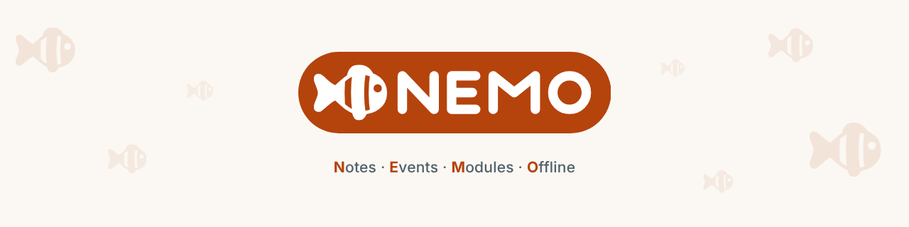
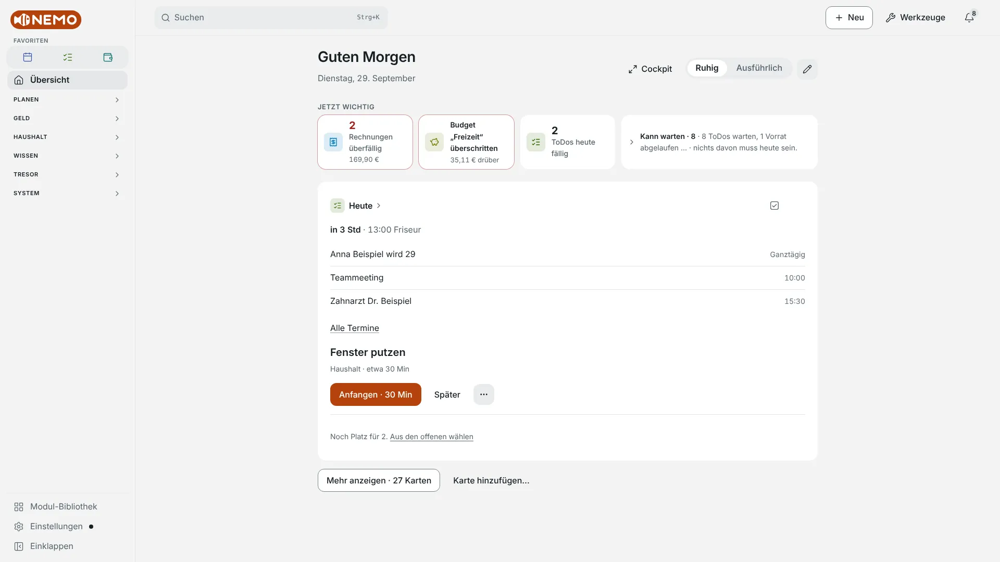
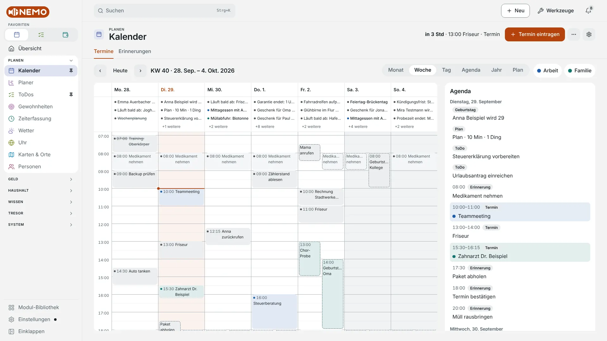
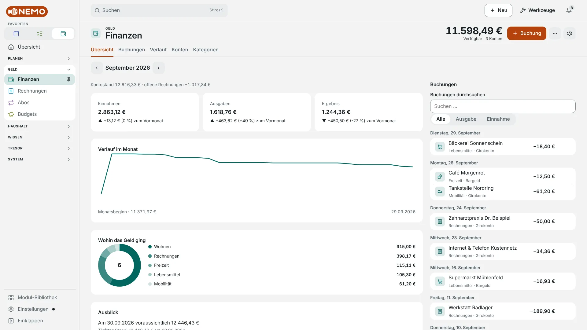
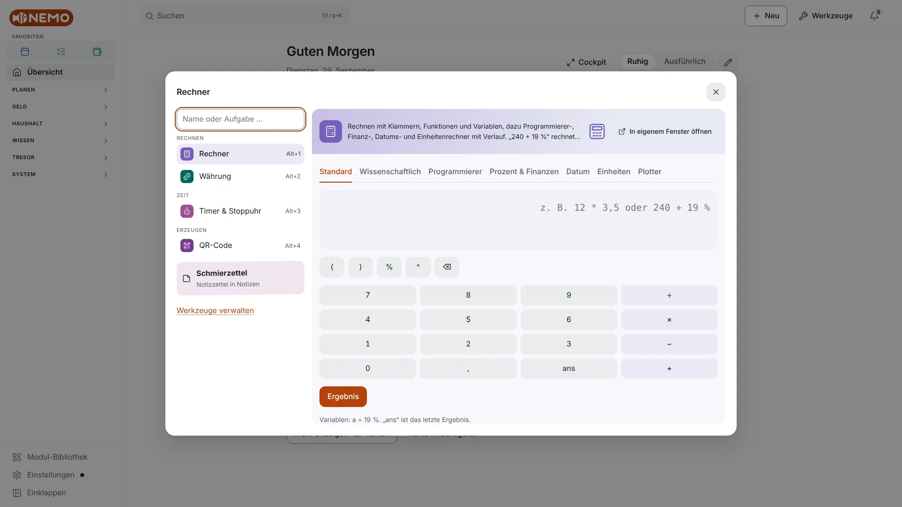
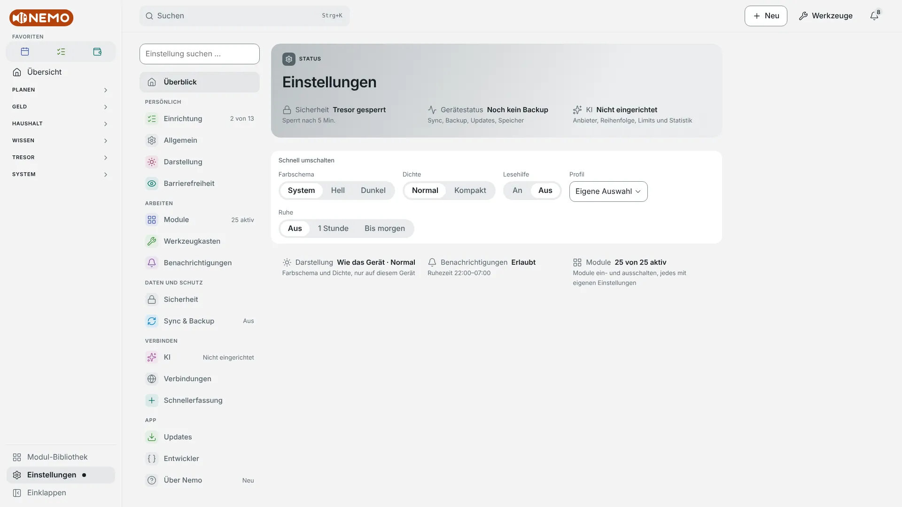
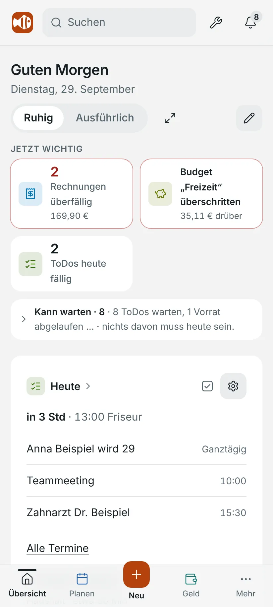
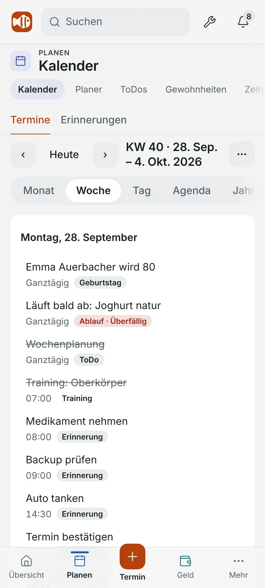
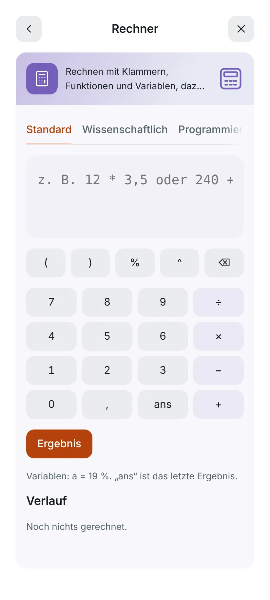

<strong>English</strong> | <a href="README.de.md">Deutsch</a>

  <picture>
    <source media="(prefers-color-scheme: dark)" srcset="docs/brand/header.png">
    
  </picture>

<h1 align="center">Nemo</h1>

A calm everyday app for Windows and Android: calendar, to-dos, money, passwords and more. Made with ADHD in mind, and your data stays on your device.

  
  
  
  
  

  
  

> **Stable or Dev preview?** The buttons give you the latest **stable** version. Beta versions and all changes are on the [Releases](https://github.com/SGNemo/schweizer-taschenmesser/releases) page. The Dev preview (see *Details* below) is an untested build of the development branch: a separate app with its own data.

  <picture>
    <source media="(prefers-color-scheme: dark)" srcset="docs/assets/screenshots/overview-desktop-dark.webp">
    
  </picture>

## What Nemo does

Nemo is a set of small modules for everyday life. You turn on what you need in the **module library**; everything works offline.

<!-- modules:start -->

| Area | Module | What it does | Status |
|---|---|---|---|
| **Plan** | Calendar | Events in month, week and day view | on by default |
|  | Planner | Spreads your open to-dos over the coming days | optional |
|  | To-dos | Tasks in lists with priorities, due date and subtasks | on by default |
|  | Habits | Daily and weekly goals with rings | optional |
|  | Time tracking | Start and stop with one click, projects and clients with colour and hourly rate | optional |
|  | Weather | A page of its own for the weather at your place | on by default |
|  | Clock | Add places and always see their time | preview |
|  | Maps & places | Places and routes you need often | preview |
|  | People | Never forget a birthday again and collect gifts per person | optional |
| **Money** | Finances | Accounts, income and expenses with categories | on by default |
|  | Invoices | Open invoices with amount, payee and due date | on by default |
|  | Subscriptions | Subscriptions and recurring payments | on by default |
|  | Budgets & savings goals | Monthly limits per expense category (from Finances) and savings goals with deposits and progress | on for new installations |
| **Household** | Lists | Shopping, packing lists and checklists | on for new installations |
|  | Pantry | What’s in the fridge, the cupboard and the freezer? | optional |
|  | Fitness | Keep a rough log of training and food | preview |
| **Knowledge** | Saved | Save links, reading, films, places and ideas | optional |
|  | Notes | Notebook with formatted text (Markdown), a fixed scratchpad always at the top, pinning and search | optional |
|  | Chat | Conversations with the built-in local model or your providers | preview |
|  | Browser | Simple browser with tabs, bookmarks and a private mode | preview, Windows and Android apps only |
|  | Feeds | Your subscribed feeds (news, blogs, podcasts) in one place, sorted by group | optional |
|  | Mail | Inbox, search and reading mail | preview, Windows app only |
|  | Music | Spotify on one page | preview |
| **Vault** | Documents | IDs, contracts, insurance and warranties with end date, notice period and an attached file | optional |
|  | Passwords | Password vault | optional |
| **System** | This PC | Drives with a scan of the biggest folders and system info (processor, memory, battery, network) | optional, Windows app only |
|  | Downloads | Downloads files | on for new installations, Windows app only |
|  | Remote | Control media and volume of your PC from your phone | preview, Android app only |

“On for new installations”: switched on when you install Nemo fresh. An installation that already existed stays as it is; there you turn the module on in the module library.

**Tools:** Calculator · Currency · Timer & stopwatch · QR code · Units · Date calculator · Time zones · Dice & random · Text tool · Shrink images · PDF tool · Screenshot (preview) · Anonymous persona · Developer · Text compare (preview) · Regex tester (preview). Open with Ctrl+. or the Tools button; more can be turned on under “Manage tools”.

Preview modules and tools stay hidden until you turn on “Show work in progress” (Settings → Appearance).

<!-- modules:end -->

Press **Ctrl+K** to search across your modules, jump anywhere or ask a question; it also calculates (“240 + 19 %”). **Quick capture** turns one line of text into an entry: a global shortcut and the tray on Windows, the share menu and app-icon shortcuts on Android. More: [Modules and tools](docs/user/modules.md), [Search and AI](docs/user/ai-assistant.md).

### Made for busy minds

Nemo is built with ADHD in mind. It helps with starting and staying on track; it is not a treatment and does not promise one. Every aid can be switched off.

- **Up next:** the overview suggests one thing to start, with a first step and a duration. The rest waits, folded away.
- **Day plan and focus mode:** a few things for today; one task at a time with its steps and a ring timer.
- **Calm reminders:** quiet hours, bundled, “later” with sensible options, no streaks to lose. They reach a closed app on Android, a running app on Windows (it can stay in the tray) and, in the browser, through Web Push from your own sync server.
- **Easier to read:** larger text, less motion, a reading aid (preview) and profiles (Calm, Work, Evening) with schedules.

### AI, optional

- **On your device, free:** built-in rules answer simple questions (“What’s on today?”) and turn a sentence like “Rechnung Stadtwerke 89,90 € fällig 15.10.” into an entry, always with a preview first. The rules understand **German only** for now.
- **Local model (Windows app):** an optional model runs offline after a one-time download.
- **Providers you choose:** Claude, OpenAI, Gemini, Groq, OpenRouter, Mistral, Ollama or your own OpenAI-compatible server, asked in order (local → free → paid) with limits and a cost overview.
- **Import with an AI:** an AI tool can deliver existing data through a local interface (Windows app, off by default, the setting is still a preview): [AI import](docs/AI-IMPORT.md).
- **Off with one switch:** Settings → AI → “Turn off AI completely”.

### Connections and import, optional

- **Google** (Windows app, with your own client ID): calendar and Mail (preview), read-only unless you allow more. **Spotify** (preview; Windows app and browser, not Android): what is playing and your playlists; Nemo plays nothing itself. **Calendar subscriptions:** any iCalendar link, no login.
- **Import from another app:** Evernote, Obsidian and Markdown, Todoist, Google Tasks, Keep and Calendar files, Notion, Microsoft To Do, bank files, Bitwarden, KeePass and 1Password exports, OPML. Every import shows a preview first and can be undone; password exports use the vault’s own import, which needs your master password.

## Screenshots

All pictures show made-up sample data in the German interface; the app also speaks English.

<table>
  <tr>
    <td width="50%">
      <picture>
        <source media="(prefers-color-scheme: dark)" srcset="docs/assets/screenshots/calendar-desktop-dark.webp">
        
      </picture>
       Calendar: week view with the day’s agenda
    </td>
    <td width="50%">
      <picture>
        <source media="(prefers-color-scheme: dark)" srcset="docs/assets/screenshots/finance-desktop-dark.webp">
        
      </picture>
       Finances: month overview with balance and transactions
    </td>
  </tr>
  <tr>
    <td width="50%">
      <picture>
        <source media="(prefers-color-scheme: dark)" srcset="docs/assets/screenshots/tools-desktop-dark.webp">
        
      </picture>
       Toolbox: the calculator, one of many small tools
    </td>
    <td width="50%">
      <picture>
        <source media="(prefers-color-scheme: dark)" srcset="docs/assets/screenshots/settings-desktop-dark.webp">
        
      </picture>
       Settings: status at a glance, then the categories
    </td>
  </tr>
</table>

  <picture>
    <source media="(prefers-color-scheme: dark)" srcset="docs/assets/screenshots/overview-phone-dark.webp">
    
  </picture>
  <picture>
    <source media="(prefers-color-scheme: dark)" srcset="docs/assets/screenshots/calendar-phone-dark.webp">
    
  </picture>
  <picture>
    <source media="(prefers-color-scheme: dark)" srcset="docs/assets/screenshots/tools-phone-dark.webp">
    
  </picture>

## Quick start

1. **Download:** Windows portable (one file, no installation) or Android APK, buttons above.
2. **Start:** on Windows, double-click the file (the first time SmartScreen asks: “More info” → “Run anyway”). On Android, open the APK and allow installing from this source.
3. **Set up:** the setup assistant walks you through modules, vault, optional sync and AI. Everything is optional and can be changed later in the settings.

More detail, including the browser (PWA) and moving from another app: [Installation](docs/user/installation.md).

## Privacy in short

- **Stored locally.** Data lives in your device’s database. No account, no Nemo cloud service.
- **Sync is optional.** Only through a server you run yourself (Docker or Node), end-to-end encrypted if you want.
- **Only what you set up leaves the device.** Update check (GitHub, can be switched off), AI providers, Google and Spotify connections, calendar subscriptions, maps (tiles, place search, routes), weather (only with a chosen place), currency rates, downloads, model download. What is sent and when: in the app under Settings → About Nemo → Legal and in [DATA-FLOWS](docs/legal/DATA-FLOWS.md).
- **Never your data to AI.** The assistant only sends your question, the date and field names, never entries. The only exceptions are ones you trigger yourself: attaching a module’s data in the chat (with a preview) or granting an AI read access through the local interface. The password vault (Argon2id, AES-256, one-time codes) is completely invisible to AI, search and import.
- **Signed updates.** Every update is checked against the project’s key before it is applied. Details: [Security](docs/user/security.md).

## Details

<strong>Installation: Windows, Android, PWA</strong>

**Windows:** one portable file, no installation and no admin rights. It needs Microsoft WebView2 (usually present on Windows 10/11). The first start may show “Windows protected your PC” (SmartScreen), because the exe has no purchased code-signing certificate: choose “More info” → “Run anyway”. The update payload is signed with the project’s key, and the app checks that signature itself. Data lives in your user profile under `%LOCALAPPDATA%\io.github.sgnemo.taschenmesser`; an empty folder `data` next to the exe makes it portable (USB stick). Updates: Settings → Updates, with an automatic backup copy first.

**Android:** open the APK and allow “Install from this source” for your browser or file manager. Later updates: Settings → Updates → “Update now”. The app downloads the update, checks its checksum and hands over to Android’s installer, which only accepts APKs signed with the same key.

**PWA:** in Chrome or Edge (Windows) or Chrome (Android), choose “Install app” (needs HTTPS or localhost). On an iPhone you can use the PWA in the browser, without push.

Full guide: [Installation](docs/user/installation.md).

<strong>Dev preview: untested builds</strong>

After a green push to `develop` that changes code, GitHub builds a preview: <a href="https://github.com/SGNemo/schweizer-taschenmesser/releases/download/dev-preview/Nemo-Portable-dev.exe">Windows</a> · <a href="https://github.com/SGNemo/schweizer-taschenmesser/releases/download/dev-preview/Nemo-dev.apk">Android</a>. It is meant for testers and may contain bugs. It is a **separate app “Nemo Dev” with its own data** and does not replace the stable app; bring data over with sync or a backup. The update channel is set in Settings → Updates.

<strong>Sync server and backup: your own server, Docker, Tailscale, push</strong>

A small Node server (Fastify + SQLite) with token login. Build the Docker image from the repository (`server/`; it also serves the PWA, and there is no published image yet) or run it directly with Node. On the go, Tailscale with HTTPS is easiest; optional Web Push delivers reminders to the PWA while it is closed. Backups are encrypted files (Settings → Sync & backup), made automatically in the installed apps. Guides: [Sync server](docs/user/sync.md), [Backup](docs/user/backup.md).

<strong>Local AI model (Windows app)</strong>

Settings → AI → “Local model” downloads a model once (from Hugging Face) and then answers offline. It is the first step for “Add with AI” and powers the Chat module (preview) without any provider. It needs a processor with AVX2; a graphics card is used if one is found. Guide: [Search and AI](docs/user/ai-assistant.md).

<strong>Browser extension (Brave)</strong>

Helps with signing up and logging in on websites using the vault of the Windows app: no vault of its own, and nothing is filled in or saved without your click. It is built for Brave (the connection to the app is also registered for Chrome, Edge and Chromium) and is installed unpacked from the build artifact `nemo-extension-*.zip`; it is not in a store. Guide: [Browser extension](docs/user/browser-extension.md).

<strong>Supporter code: voluntary, cosmetic only</strong>

Nemo is and stays free, and every feature is open to everyone. If you want to support the project voluntarily (any amount, one-off) via [Ko-fi](https://ko-fi.com/nemojr), you get a supporter code by e-mail as a thank-you. It unlocks purely cosmetic extras: a “thank you” badge, additional colour themes and the logo in the theme colour. You enter the code under Settings → About Nemo → Supporter; it is checked only on your device, without an account and without tracking. Payment happens solely on the payment provider’s page; the app never handles payment data. More: [SUPPORT.md](SUPPORT.md).

<strong>FAQ</strong>

- **Why does Windows warn me on first start?** The exe has no purchased code-signing certificate. The update payload is still signed and checked by the app.
- **Is there an iOS version?** No. On the iPhone you can use the PWA in the browser (without push).
- **Can I export my data?** Yes, Settings → Sync & backup creates a file with everything except credentials; the vault has its own encrypted export.
- **Isn’t the project called “Schweizer Taschenmesser”?** That was the old name. Technical identifiers (package name, file paths) keep it so updates and data stay intact.
- **Is Nemo free?** Yes, MIT licence. Costs only arise with paid AI providers you set up yourself.

More: [FAQ](docs/user/faq.md).

## More

- Website: [Deutsch](https://nemo-adhd-helper.online) · [English](https://nemo-adhd-helper.online/en)
- [Documentation](docs/README.md) for users and developers
- [Roadmap](docs/ROADMAP.md) with ideas for later versions
- [Changelog](CHANGELOG.md)
- [Contributing](CONTRIBUTING.md), [report a security issue](SECURITY.md), [Support](SUPPORT.md), [Code of conduct](CODE_OF_CONDUCT.md)
- Support the project on [Ko-fi](https://ko-fi.com/nemojr)
- [License: MIT](LICENSE). The Nemo logo and name are drawn for and meant for this project; please use your own for forks.
