# QA-Bericht: Lena, Pflegekraft mit Wechselschicht

## Kopf
- **Persona:** Lena, 34, Pflegekraft, wechselnde Schichten (Früh/Spät/Nacht). Nutzt fast nur das Handy (Android, Mittelklasse, 4 GB RAM), oft einhändig, in Pausen, unter Zeitdruck.
- **Ziele:** Schichtplan im Kalender, Rechnungen und Abos im Blick (Geld knapp), Einkauf und Vorräte, Medikamenten-Erinnerung für die Mutter, Geburtstage.
- **Haltung:** keine Technikerin, wenig Geduld für Einrichtung; was länger als eine Minute dauert, lässt sie. Kein eigener Server, versteht „Tailscale“ nicht.
- **Plattform:** Android-Handy simuliert (Chromium, Viewport 412×915, Touch, de-DE, Europe/Berlin). Kurz geprüft: 320×568, 820×600, Desktop 1280×800. **Nicht geprüft:** echte APK, echtes Handy, Push, Sync-Server (siehe „Grenzen des Tests“).
- **Build:** `develop` @ `4af432d`, Web 1.0.0; Vite-Dev (frische Datenbank auf :5174, Dev-Preview mit Testdaten `medium` auf :5173) und Produktions-Build mit Service Worker (:4173).
- **Datum:** 2026-10-29. **Dauer:** eine Testsitzung (ca. 1,5 Std. Wanduhr, inkl. Aufbau).

## Zusammenfassung
11 Fehler: 0 blocker, 2 hoch, 3 mittel, 6 niedrig. 11 Verbesserungen (4 mit hohem Nutzen). Die App ist ruhig und schnell, aber Lenas Kernaufgabe „Schichten eintragen und überblicken“ ist unbequem, die Einkaufsliste hat eine Tap-Falle, und die Medikamenten-Erinnerung hängt (laut App-Text) ohne Sync-Server an der geöffneten App.

## Testverlauf in Kurzform
1. **Erster Eindruck:** README/Website gelesen (Versprechen: „ruhige App, ohne Konto, ohne Cloud“, passt zu Lena). Frische App: Willkommenskarte, Einrichtung mit 12 Schritten. Lena hätte nach Schritt 3–5 (Profil, Werkzeugkasten, KI-Anbieter) abgebrochen; für den Bericht wurden alle 12 durchgeklickt (Screenshots 03-setup-step03/07).
2. **Ziele:** Schichten (4 Dienste angelegt), Medikamente, Rechnung/Abo-Formulare, Einkauf, Geburtstage (Personen), Backup.
3. **Ein Tag:** Morgenüberblick (befüllte App), drei Schnellerfassungen (Zahnarzt, Tabletten, Milch), Erinnerung, Einkauf intensiv, Abschluss mit Sicherung.
4. **Grenzen:** langer Titel, Löschen/Rückgängig, Backup erstellen und in leere App einspielen (21 Einträge zurück), Offline-Reload (Service Worker ok), 6-fach gedrosselte CPU, kleines Fenster, Dark-Theme, Englisch.
5. **Unerwartetes:** Modul-Bibliothek, Werkzeuge, Einstellungen, Suche, Schnell-hinzufügen-Sheet.

### Tap-Zählung (Lena, Handy)
| Aufgabe | Taps | Bewertung |
|---|---|---|
| Einrichtung komplett | ca. 14 Taps, 12 Bildschirme | zu lang, > 1 Minute |
| Ein Dienst im Kalender (Titel, Datum, Beginn, Ende) | ca. 15–18 inkl. Picker | zu viel für ca. 15 Dienste/Monat |
| Tägliche Erinnerung per Schnellerfassung | 4 (Plus, Text, Speichern) | sehr gut |
| Rechnung anlegen | 3 Felder + Speichern ≈ 7 | gut |
| Artikel zur Einkaufsliste | 2 (Feld, Enter) | gut |
| Artikel abhaken | 1 (rechtes Kästchen) / falsch bei linkem | siehe B-01 |

## Fehler

### B-01 · Einkaufsliste: zwei Kästchen pro Zeile, das linke wählt nur aus statt abzuhaken
- **Schwere:** hoch · **Plattform:** Android-Viewport 412x915 (PWA) · **Häufigkeit:** immer
- **Schritte:**
  1. Haushalt → Listen → Einkauf öffnen
  2. Das linke, ganz außen liegende Kästchen bei „Milch“ antippen
- **Erwartet:** Artikel ist abgehakt (so verhalten sich alle Einkaufslisten-Apps).
- **Tatsächlich:** Es erscheint eine Leiste „1 ausgewählt · Abhaken · Löschen · Abbrechen“. Abgehakt wird erst mit dem zweiten, rechten Kästchen. Beide sehen gleich aus; das linke trägt nur das Etikett „Auswählen“. Im Laden (einhändig, im Gehen) trifft man oft das falsche; daneben liegt der Papierkorb.
- **Screenshot:** 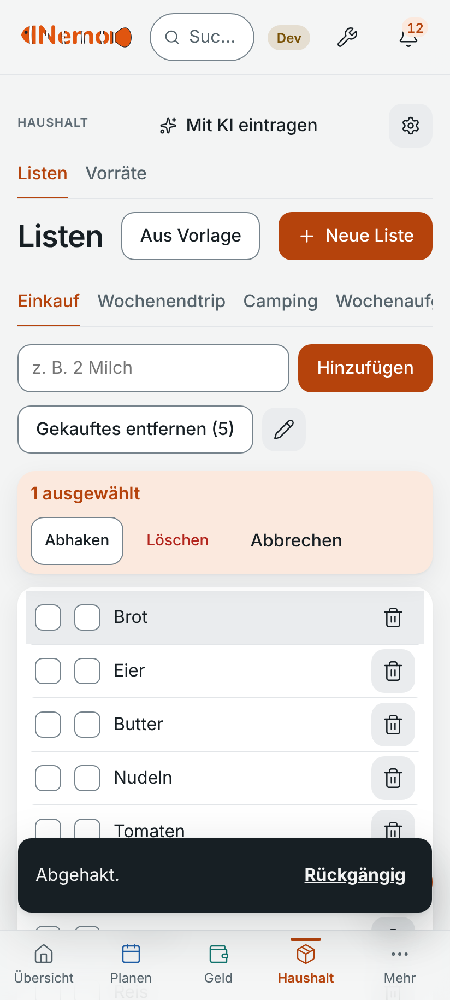

### B-02 · Medikamenten-Erinnerung: bei geschlossener App nur mit Sync-Server-Push zugestellt (laut App-Text)
- **Schwere:** hoch · **Plattform:** Browser/PWA (APK nicht prüfbar) · **Häufigkeit:** immer (laut UI-Text)
- **Schritte:**
  1. Schnell hinzufügen: „jeden Tag 8 Uhr Tabletten Mama“ → Speichern
  2. Einstellungen → Benachrichtigungen lesen
- **Erwartet:** Eine täglich wiederkehrende Erinnerung klingelt auch, wenn die App zu ist.
- **Tatsächlich:** Der Text sagt: „Bei geschlossener App kommen sie nur mit Push (siehe unten)“, und Push braucht „deinen Sync-Server“. Lena hat keinen. Die Erinnerung wird im Browser/PWA also nur geliefert, solange die App läuft. Im Dev-Build gespeichert und angezeigt (Jetzt wichtig), aber nirgends ein Hinweis beim Speichern, dass sie ohne Server evtl. nicht kommt. Ob die Android-APK lokal plant, konnte ohne Gerät nicht geprüft werden (README sagt „reminders even when the app is closed“, dann widerspricht der Einstellungstext dem).
- **Screenshot:** 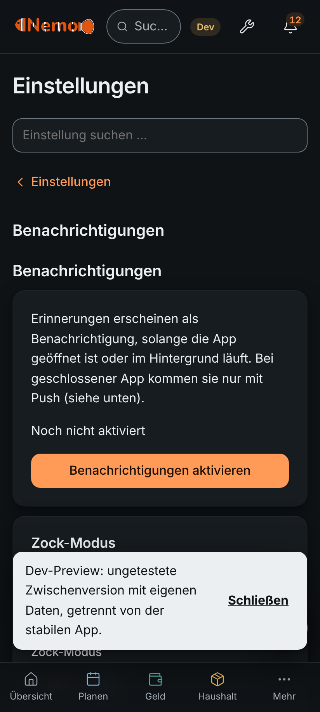

### B-03 · Willkommenskarte überdeckt das Lesehilfe-Angebot; Text abgeschnitten, Schalter nicht bedienbar
- **Schwere:** mittel · **Plattform:** Android-Viewport 412x915 · **Häufigkeit:** immer bei leerer App
- **Schritte:**
  1. Frische Installation öffnen (leere Datenbank)
  2. Startseite ansehen
- **Erwartet:** Zwei getrennte, lesbare Hinweise oder einer.
- **Tatsächlich:** In der Karte „Willkommen bei Nemo“ sind zwei Sätze mit „…“ abgeschnitten („…in den Einstellungen…“, „…abschalten.…“). Die Knöpfe „Einschalten / Nicht jetzt“ der Lesehilfe liegen laut DOM bei y≈292 px genau unter den Knöpfen „Einrichtung starten / Später“; sichtbar sind sie nicht. Der erste Eindruck wirkt kaputt. Tritt auch nach Backup-Import in leere App auf.
- **Screenshot:** 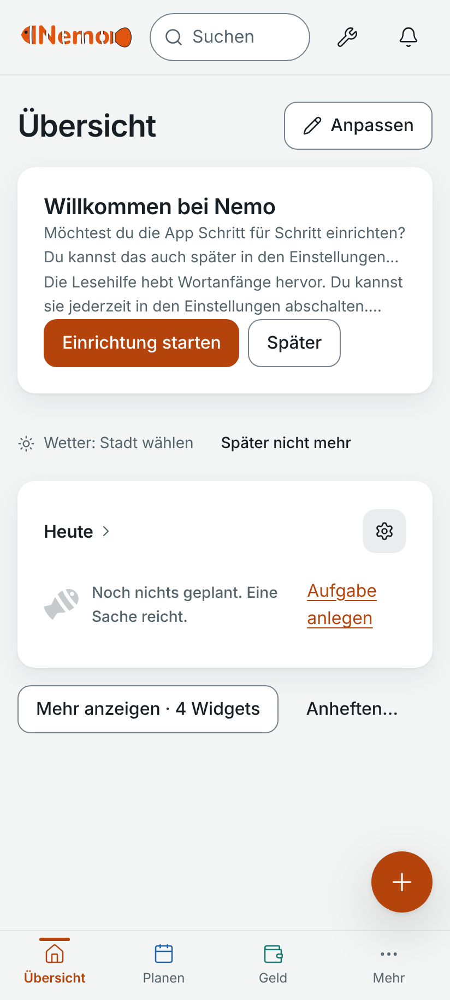

### B-04 · Runder „+“-Knopf verdeckt Bedienelemente und Inhalte
- **Schwere:** mittel · **Plattform:** Android-Viewport 412x915 · **Häufigkeit:** immer
- **Schritte:**
  1. Planen → Kalender, Monat, nach unten scrollen (letzte Spalte, So 25 ist verdeckt)
  2. Mehr → Werkzeuge: Schalter bei „Währung“ liegt unter dem Knopf
- **Erwartet:** Inhalt und Schalter bleiben erreichbar.
- **Tatsächlich:** Der Knopf liegt über dem rechten Rand; dort sitzen oft Schalter, Papierkörbe, Sonntagsspalte. Muss erst weiter scrollen oder daneben tippen.
- **Screenshot:** 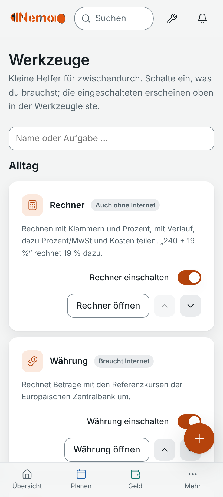

### B-05 · „Heute“ sagt „Noch nichts geplant“, obwohl „Jetzt wichtig“ eine Erinnerung für heute zeigt
- **Schwere:** mittel · **Plattform:** Android-Viewport 412x915 · **Häufigkeit:** immer
- **Schritte:**
  1. Erinnerung „Tabletten Mama“ heute 08:00 anlegen
  2. Startseite öffnen
- **Erwartet:** „Heute“ enthält die Erinnerung oder spricht nicht von „nichts geplant“.
- **Tatsächlich:** Oben „Jetzt wichtig: Tabletten Mama, heute um 08:00“, direkt darunter „Heute · Noch nichts geplant. Eine Sache reicht.“ Wirkt widersprüchlich; die Karte „Heute“ kennt nur ToDos.
- **Screenshot:** 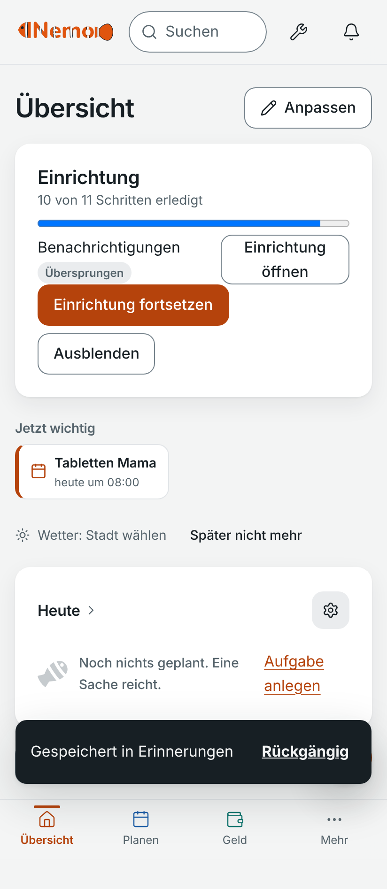

### B-06 · Einrichtung: „Schritt x von 12“, später „10 von 11 Schritten erledigt“; Karte bleibt mit drei Knöpfen auf der Startseite
- **Schwere:** niedrig · **Plattform:** Android-Viewport 412x915 · **Häufigkeit:** immer
- **Schritte:**
  1. Einrichtung durchklicken, Benachrichtigungen überspringen
  2. Startseite ansehen
- **Erwartet:** Eine Zahl, und die Karte verschwindet oder hat einen Knopf.
- **Tatsächlich:** Zahlen passen nicht zusammen. Es bleibt die Karte „Einrichtung“ mit „Einrichtung öffnen“, „Einrichtung fortsetzen“ und „Ausblenden“ (die ersten zwei tun fast dasselbe). Das übersprungene Benachrichtigungen-Häkchen hält sie dauerhaft sichtbar.
- **Screenshot:** 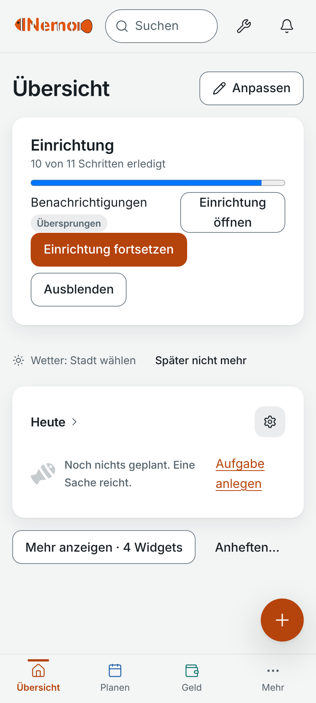

### B-07 · Kalender-Kopf: Bereichsauswahl „Kalender“ wird zum Schnipsel zusammengedrückt; bei 320 px Tab „Personen“ und Suchfeld abgeschnitten
- **Schwere:** niedrig · **Plattform:** 320x568 und Desktop 1280x800 · **Häufigkeit:** immer
- **Schritte:**
  1. Fenster auf 320 px (oder Desktop-Breite) ziehen, Planen → Kalender
- **Erwartet:** Alle Tabs/Chips lesbar.
- **Tatsächlich:** Die Pille neben „Kalender“ ist nur ein Strich/Halbkreis, das Suchfeld zeigt „S.“, der Tab „Personen“ fehlt.
- **Screenshot:** 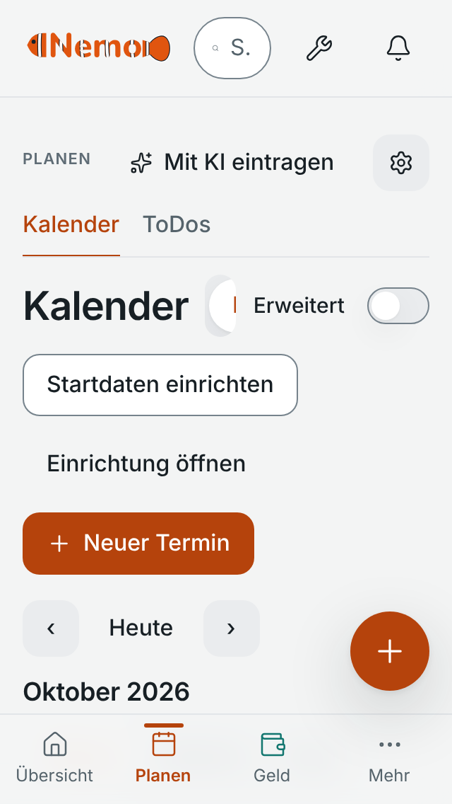

### B-08 · Mehrtägiger Nachtdienst zeigt nur Beginn („21:30“), kein Ende
- **Schwere:** niedrig · **Plattform:** Android-Viewport 412x915 · **Häufigkeit:** immer
- **Schritte:**
  1. Termin „Nachtdienst“ 1.11. 21:30, Ende 2.11. 06:30 anlegen
  2. Wochenliste ansehen
- **Erwartet:** „21:30–06:30“ oder „bis Mo 06:30“.
- **Tatsächlich:** Nur „21:30“. Ob 6:30 gespeichert ist, sieht man erst im Bearbeiten-Dialog.
- **Screenshot:** 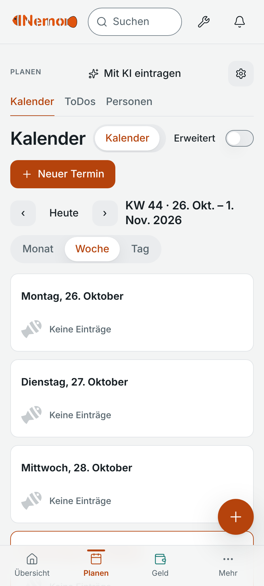

### B-09 · Englische Oberfläche: Schnellerfassung zeigt „06:00 Uhr“
- **Schwere:** niedrig · **Plattform:** Android-Viewport 412x915 · **Häufigkeit:** immer
- **Schritte:**
  1. Einstellungen → Allgemein → English
  2. Schnellerfassung: „Frühdienst morgen 6 Uhr“ eintippen
- **Erwartet:** „06:00“ bzw. englisches Zeitformat.
- **Tatsächlich:** Chip „06:00 Uhr“ bleibt deutsch.
- **Screenshot:** 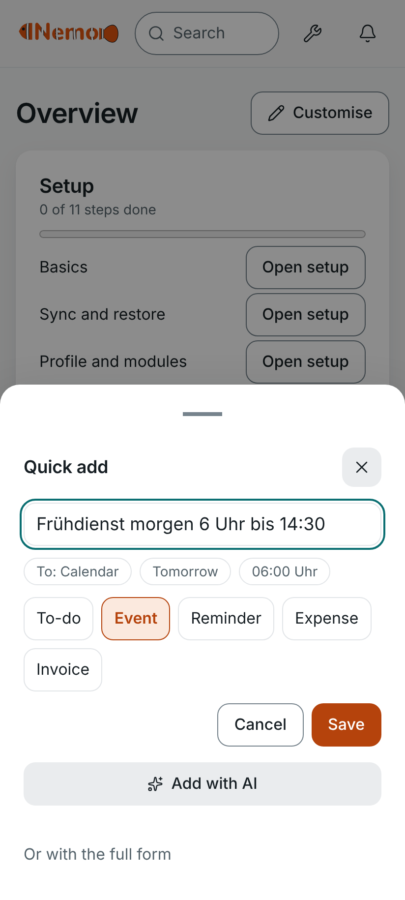

### B-10 · Datum/Uhrzeit-Felder zeigen US-Format („10/29/2026“, „09:00 AM“) in deutscher Oberfläche
- **Schwere:** niedrig · **Plattform:** Chromium-Testumgebung (unsicher) · **Häufigkeit:** immer in dieser Umgebung
- **Schritte:**
  1. Planen → Neuer Termin
- **Erwartet:** 29.10.2026 / 09:00.
- **Tatsächlich:** US-Format, Platzhalter „mm/dd/yyyy“. Kann an der Test-Chromium-Locale liegen (native Eingabefelder folgen dem System), auf dem Handy der Persona nicht verifiziert. Notiert, weil Lena sich bei 05.11. vs. 11.05. vertun würde.
- **Screenshot:** 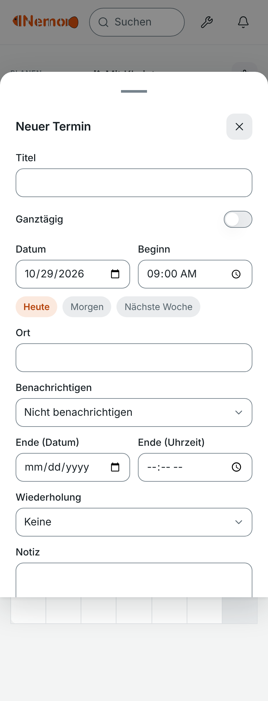

### B-11 · Zwei gestapelte Hinweise („Abgehakt.“, „1 Eintrag gelöscht.“) verdecken ca. ein Fünftel des Bildschirms samt Navigation
- **Schwere:** niedrig · **Plattform:** Android-Viewport 412x915 · **Häufigkeit:** immer
- **Schritte:**
  1. Einkauf: einen Artikel abhaken, gleich danach einen löschen
- **Erwartet:** Hinweise stören die Liste nicht, oder ein einzelner Hinweis.
- **Tatsächlich:** Beide stehen übereinander über den letzten Zeilen und der unteren Leiste, solange sie sichtbar sind.
- **Screenshot:** 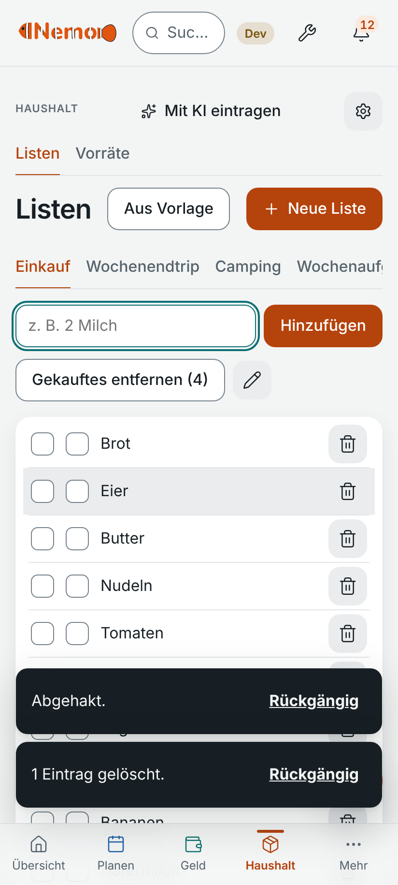

## Verbesserungen

### V-01 · Einrichtung auf 3 Schritte kürzen, Rest später anbieten
- **Nutzen für Lena:** hoch
- **Situation:** Lena will in unter einer Minute loslegen.
- **Problem heute:** 12 Schritte, darunter KI-Anbieter, Konten verknüpfen, Import per KI, Werkzeugkasten, Backup, Sync. Nach Schritt 3 (Profil wählen) hätte sie abgebrochen. „Weiter“ geht auch ohne Profilwahl.
- **Vorschlag:** Nur Sprache/Name, Profil („Alltag“ vorauswählen), Benachrichtigungen. Alles andere als einzelne Hinweise, wenn Lena das Modul erstmals öffnet.
- **Anregung:** Banking-Apps, die erst beim ersten Bedarf nach Rechten fragen.

### V-02 · Schicht-Vorlagen mit festen Zeiten und Ende direkt sichtbar
- **Nutzen für Lena:** hoch
- **Situation:** Lena trägt ca. 15 Dienste im Monat ein (Früh 06:00–14:30, Spät 13:30–22:00, Nacht 21:30–06:30).
- **Problem heute:** Pro Dienst: Planen, Neuer Termin, Titel, Datum, Beginn, „Mehr Felder“, Ende, Speichern ≈ 15–18 Taps mit nativen Pickern, ca. 1–2 Min. Ende steht hinter „Mehr Felder“. Schnellerfassung erkennt „6 Uhr“, verwirft aber „bis 14:30“. „Duplizieren“ existiert, spart aber nicht das Datum.
- **Vorschlag:** „Schicht eintragen“: drei Vorlagen-Kacheln, dann nur Tage im Monatsraster antippen. Schnellerfassung soll „6–14:30“ als Zeitspanne lesen. Eigene Schichtnamen/-zeiten speicherbar.
- **Anregung:** Schichtplan-Apps (z. B. Shift-Kalender) mit Tippen-auf-Tage-Eintrag.

### V-03 · Monatsansicht: Dienstart je Tag sichtbar (Kürzel/Farbe + Text)
- **Nutzen für Lena:** hoch
- **Situation:** Lena will auf einen Blick sehen, wann sie Früh/Spät/Nacht hat.
- **Problem heute:** Der Monat zeigt für jeden Termin denselben orangen Punkt. Den Dienst sieht man nur in Woche/Tag.
- **Vorschlag:** Kürzel „F/S/N“ in der Zelle oder Titelanfang; Farbe nur zusätzlich zu Text.
- **Anregung:** Google Kalender zeigt Titel in der Zelle.

### V-04 · „Zock-Modus“/„Stumm“ zu einem verständlichen „Ruhe“ zusammenlegen, an Schichten koppelbar
- **Nutzen für Lena:** hoch
- **Situation:** Nach der Nachtschicht schläft Lena tagsüber und will keine Töne, Mamas Tabletten sollen aber kommen.
- **Problem heute:** Zwei getrennte Funktionen: „Stumm: Aus / 1 Stunde / Bis morgen“ in den Einstellungen und „Zock-Modus“ in Benachrichtigungen; dazu „Ruhezeit 22–07 Uhr“. Der Name „Zock-Modus“ sagt Lena nichts. Eine feste Ruhezeit passt nicht zu wechselnden Schichten.
- **Vorschlag:** Ein Begriff („Nicht stören“), erreichbar von der Startseite, Zeitfenster pro Tag oder automatisch während eines Eintrags „Nachtdienst/Frei“.
- **Anregung:** Android „Bitte nicht stören“ mit Zeitplan.

### V-05 · Medikamenten-Erinnerung als eigener, ehrlicher Weg: Zustell-Hinweis und „genommen“-Bestätigung
- **Nutzen für Lena:** hoch
- **Situation:** Mama muss morgens und abends ihre Tabletten nehmen.
- **Problem heute:** Erinnerung wird wie ein Kalendereintrag gespeichert (mit „Erinnerungen“-Knopf, der nur „Nächste/Zufällige Erinnerung“ zeigt, nichts anlegen lässt). Kein Hinweis beim Speichern, ob sie auch bei geschlossener App kommt; keine Bestätigung.
- **Vorschlag:** Beim Speichern einer Erinnerung kurz prüfen und sagen: „Kommt auch bei geschlossener App“ oder „Nur bei geöffneter App – hier erlauben“. Optional Knopf „Genommen“ in der Benachrichtigung ohne Schuldtext.
- **Anregung:** Medikamentenerinnerungs-Apps mit Tippen-zum-Bestätigen.

### V-06 · Schnellerfassung soll Abo, Rechnung und Geburtstag erkennen
- **Nutzen für Lena:** mittel
- **Situation:** „Netflix 12,99 monatlich“, „Strom 54,30 Euro bis Freitag“, „Geburtstag Anna 14.11.“
- **Problem heute:** Netflix wird zur monatlichen Erinnerung ohne Betrag; Strom wird „Ausgabe 54,30 €“ statt Rechnung (Chip muss von Hand gewechselt werden); Geburtstag wird ToDo. Es gibt keinen Abo- und keinen Personen-Chip.
- **Vorschlag:** Ziel-Chips Abo und Person ergänzen; Betrag + „bis“ → Rechnung vorschlagen.

### V-07 · Morgenüberblick: ein kompakter Block „Heute“ statt 16 Widgets
- **Nutzen für Lena:** mittel
- **Situation:** Morgens in der Pause: Dienst heute? Was ist fällig? Tabletten?
- **Problem heute:** Standard ist sehr ruhig (gut), aber dann fehlt Dienst/Termine; alles Weitere hinter „Mehr anzeigen · 16 Widgets“ ergibt eine Seite von ca. 6,7 Bildschirmhöhen.
- **Vorschlag:** Option „Tagesblock“: Dienst/Termine heute, fällige Rechnungen, heutige Erinnerungen in einer Karte; „Mehr anzeigen“ nach Modul gruppieren.

### V-08 · „Sync & Backup“: Backup zuerst, Server-Teil zugeklappt
- **Nutzen für Lena:** mittel
- **Situation:** Lena will nur eine Sicherung.
- **Problem heute:** Seite beginnt mit Server-Adresse, Zugangstoken, Ende-zu-Ende, Passphrase, Tailscale. Backup steht darunter; „Backup-Datei“ und „Backup prüfen“ vs. „Importieren“ sind nicht selbsterklärend. (Der Import selbst ist gut gemacht, siehe „Was gut ist“.)
- **Vorschlag:** Reihenfolge tauschen, Synchronisation unter „Erweitert“ einklappen.

### V-09 · Wiederholung für Schichtrhythmen (alle 2 Wochen, Mo–Fr)
- **Nutzen für Lena:** mittel
- **Situation:** Teilweise gleiche Dienste über Wochen.
- **Problem heute:** Wiederholung kennt nur täglich/wöchentlich/monatlich/jährlich; „Mo–Fr“ in der Schnellerfassung wird ignoriert („Datum angenommen: heute“).
- **Vorschlag:** Wochentage wählbar, Intervall (alle 2 Wochen).

### V-10 · Finanzübersicht: Einnahmen/Ausgaben/Saldo nebeneinander
- **Nutzen für Lena:** niedrig
- **Situation:** Geld ist knapp, Lena will schnell den Monat sehen.
- **Problem heute:** Auf dem Handy belegen Kontostand, Einnahmen, Ausgaben und Saldo je eine volle Breite, der Monat ist erst nach 2 Bildschirmen komplett.
- **Vorschlag:** Einnahmen/Ausgaben/Saldo in einer Zeile.

### V-11 · Einkauf: Streichen/Tippen auf die ganze Zeile zum Abhaken, Papierkorb weg von der Daumenzone
- **Nutzen für Lena:** niedrig
- **Situation:** Einhändig im Laden.
- **Problem heute:** Siehe B-01; Papierkorb liegt direkt neben dem Kästchen, Rückgängig-Hinweis ist aber da (gut).
- **Vorschlag:** Ganze Zeile antippen = abhaken; Auswahl über das Stift-Symbol.
- **Anregung:** Bring!, Google Keep Einkaufslisten.

## Was gut ist (bitte behalten)
1. **Schnellerfassung mit Alltagssprache:** „jeden Tag 8 Uhr Tabletten Mama“ wird richtig als tägliche Erinnerung um 08:00 erkannt, mit Vorschau-Chips und „Rückgängig“. Bestes Feature für Lena.
2. **Ehrliche Unsicherheit:** „Datum angenommen“ statt stillem Raten.
3. **Rückgängig überall** (Abhaken, Löschen) statt Bestätigungsdialogen.
4. **Ruhige Startseite:** „Jetzt wichtig“, „3 Dinge reichen für heute“, kein Alarm-Rot, keine Schuldtexte.
5. **Rechnungen** nach „Überfällig / Diese Woche / Später“ mit „seit 12 Tagen“ und Betrag; Rechnungsformular nur 3 Pflichtfelder; Abos mit „Kündigen bis“ und Summe pro Monat/Jahr.
6. **Backup-Wiederherstellung:** Vorschau („21 kommen dazu, 0 ersetzt, 0 gelöscht“), Wahl Zusammenführen/Ersetzen, automatische Sicherheitskopie vorher. Funktionierte im Test auf Anhieb.
7. **Offline:** Produktions-Build lädt per Service Worker ohne Netz; Start ca. 2,3 s bei 6-fach gedrosselter CPU.
8. **„Stumm: 1 Stunde / Bis morgen“** in den Einstellungen: genau das, was Lena nach der Nachtschicht will (nur der Name „Zock-Modus“ nicht, siehe unten).
9. **Duplizieren** im Termin-Dialog und „Gekauftes entfernen (4)“ in der Einkaufsliste.
10. **Wochenansicht als lesbare Tagesliste**, Dark-Theme sauber, Sprachwechsel greift sofort, Modul-Bibliothek mit „nur, was du brauchst“.

## Verständnis (Begriffe, die Lena nicht oder falsch versteht)
| Begriff / Stelle | Warum unklar | Vorschlag |
|---|---|---|
| „Zock-Modus“ | Klingt nach Gaming; es ist „nicht stören“ und doppelt zu „Stumm“ | „Nicht stören“, eine Funktion |
| „Wartet noch“ (Startseite, ToDos) | Wer wartet worauf? | „Verschoben“ / „Später“ |
| „Startdaten einrichten“ (über jedem Modul) | Unklar, was Startdaten sind, wirkt wie Pflicht | „Beispieldaten/Import“, kleiner, nur bei leerem Modul |
| „Erweitert“-Schalter (Kalender, Finanzen, …) | Was wird erweitert? | Beschriften („Mehr Optionen anzeigen“) |
| „Kalender“-Pille neben der Überschrift „Kalender“ | Zweimal dasselbe; wirkt wie Fehler | weglassen, wenn nur ein Kalender |
| „Erinnerungen“-Knopf im Kalender | Öffnet „Nächste/Zufällige Erinnerung“, man kann nichts anlegen | „Offene Erinnerungen“ |
| „Mit KI eintragen“ (überall) | Lena will keine KI; Knopf dominiert den Kopf | nur zeigen, wenn KI eingerichtet |
| „Auswählen“ (Kästchen in der Liste) | siehe B-01 | Auswahlmodus über Stift-Symbol |
| „Merkliste/Merkzettel/Lesezeichen“ | Drei Wörter für ähnliches | ein Wort |
| „Gestaffelte / Ruhige Erinnerung“, „Ruhezeit“ | Viele Einstellungen ohne Beispiel | Voreinstellung „Standard/Schicht“ |
| Sync: „Zugangstoken, Passphrase, Chiffretext, Tailscale“ | Für Lena unverständlich (zu Recht „egal“) | einklappen (V-08) |
| „Zeitzone … Wanduhrzeit“ (Einrichtung Schritt 1) | Fachwort | streichen |
| „Haushalt“ = Listen + Vorräte, „Unterlagen/Tresor/Accounts“ | Accounts klingt nach Benutzerkonto | „Passwörter“ |
| Zwei Kästchen pro Zeile | siehe B-01 | siehe B-01 |

## Tagesurteil
**Bedingt ja.** Lena würde die App für Schnellnotizen, Einkauf und Rechnungen behalten (ruhig, schnell, offline, Rückgängig). Als Schichtplaner ist sie ihr zu umständlich (V-02/V-03), und das Einrichten hätte sie schon vorher vertrieben (V-01). **Der eine Grund zum Deinstallieren:** Mamas Tabletten-Erinnerung kommt nicht, wenn die App zu ist (B-02) – einmal verpasst, vertraut sie der App nichts Wichtiges mehr an.

## Grenzen des Tests (ehrlich)
- Keine echte Android-APK, kein Emulator, keine Push-Zustellung: B-02 stützt sich auf den App-Text, nicht auf einen Zustelltest. Bitte auf einem Gerät gegenprüfen (Erinnerung setzen, App wegwischen, Bildschirm aus).
- Sync mit Server nicht getestet (Lena hat keinen); Google-/ICS-Verbindungen nicht getestet.
- Echtes „Handy-Gefühl“ (Daumenreichweite, Tastatur, native Picker, Schriftgröße) nur über Viewport simuliert. B-10 (US-Datumsformat) könnte ein Artefakt der Test-Chromium-Locale sein.
- In der Dev-Preview mit Testdaten enthielt eine Sicherung nur selbst angelegte Einträge (ca. 1 KB), nicht die Seed-Zeilen; das wurde als Dev-Eigenheit gewertet und nicht als Fehler gemeldet.
- Doppelte „Tabletten Mama“-Einträge in der Wochenliste stammen von zwei Testläufen, kein App-Fehler.
- Nicht gelesen: Entwickler-Doku, Design-Spezifikation, Tests (laut Auftrag).
